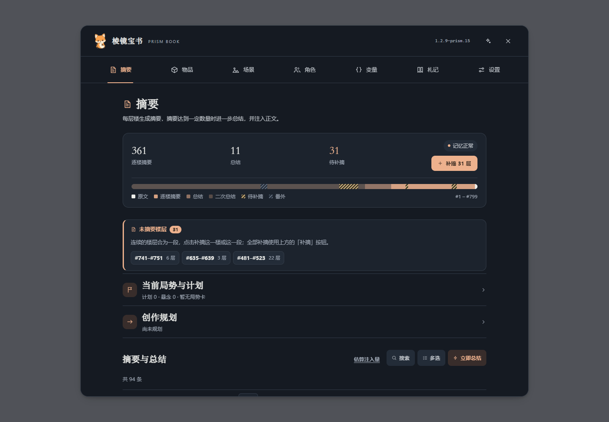

# 棱镜宝书 · Prism Book

SillyTavern 的长期记忆扩展。基于柏柏的 [ST-BaiBai-Book](https://github.com/baibai-git/ST-BaiBai-Book) 修改，由维护者公开分发，不是原作者的官方版本。原作信息和授权范围见 [NOTICE.md](NOTICE.md)，每个版本的改动见 [CHANGELOG.md](CHANGELOG.md)。

安装、设置和各项功能的用法见 [使用说明书](docs/使用说明书.md)。

截图取自本地测试页面，使用虚构的演示数据。

## 功能

- 摘要：每层楼生成摘要，摘要达到一定数量时进一步总结（L1、L2……）。生成正文时，较早的剧情以摘要代替原文注入，节省上下文。
- 状态：生成摘要时同时记录时间地点、物品、场景、角色、计划和悬念、信息差、自定义变量，各有独立页面，均可手动修改；可选记录各角色对主角的了解（默认关闭）。
- 双子札记：模型在故事外就后续剧情提出问题，经确认的方案作为「安排」。使用独立的 API，默认关闭。见 [双子札记说明](docs/双子札记.md)。
- 创作规划：位于摘要页「创作规划」，根据剧情和用户要求生成分阶段规划，确认后只将当前阶段注入正文；可先在「规划讨论」中与对话角色 Qiheng（可换成自定义角色）讨论，再按讨论生成草稿；可以调整规划在正文里推进的快慢。见 [创作规划说明](docs/大纲规划.md)。
- 世界书：根据剧情生成世界书条目的建议，审核后写入所选的世界书，写入的改动可以撤销。修改权限分只新增、可补充、可修改三档，默认只新增；可开启自动建议，所有写入都需要确认。见 [世界书说明](docs/世界书.md)。
- 向量记忆（可选）：从旧剧情中检索与当前剧情相关的片段，注入正文。

## 1.4.4 的改动

参照原版柏宝书 1.3.5 修订摘要提示词，旧聊天不需要重新摘要。

- 角色位置不再要求附正文原句，状态清单也不再要求：这两项对不上时会整楼重发请求，合法的位置还会被去掉。当面互动的角色，位置通常记为主角所在地点。
- 主角到过的有名地点都建档，写不出特征时只建地点、不写描述；主角位置对不上最细一级时取能确认的上级，离开某处默认仍在其上级区域内。角色是否在场按地点树判断，主角位置能对应到地点时，同在一处的角色按在场处理。场景页添加和编辑地点时描述可以留空。
- 输出前核查改为逐项盘点（位置、主角、人物、局势、物品、生活小档案、计划与悬念等），减少漏记；总结和二次总结用压缩专用的核查。
- 物品数不清时按包装记一份；约定对象已死等客观上不可能的计划可以了结；局势卡日常写氛围、剧情写处境。
- 照旧版内置模板改写、还写着伤情补丁或定位原句的自定义模板，会补发一段写法更正。

## 1.4.3 的改动

- 内容边界是否发送可以自选：「设置 → 提示词 → 自定义提示词 → 内容边界」可选「自动（按模型名）」（默认，与以前相同：模型名含 deepseek 时不发送，其他模型发送）、「始终发送」和「不发送」。中转站给 DeepSeek 起了不含 deepseek 的别名、自动识别不了时，可以直接选「不发送」。

## 1.4.2 的改动

- 伤情改为整段记录：有变化时写变化后的完整状态，已恢复的部分删去。以前只能按片段编号删改、每处都要附原话，没明说好了的旧伤一直挂着，伤情记录越积越长。旧聊天不需要重新摘要。
- 检索重写固定写 5 条检索语句，从不同角度查找旧事，减少漏召回；每次重写略慢。
- 新增「角色对主角的了解」（默认关闭，在「设置 → 注入设置」开启）：记录每个角色知道或以为的主角的事，注入时说明没记下的主角私事按该角色不知道处理，避免角色凭人设或世界书对主角全知。角色卡最下方可查看、添加、修改和删除。
- 角色页清空着装、身体状态、性别、年龄、人际关系或性格后保存即生效。
- 「重建记忆」改为「全部重新摘要」，入口移到摘要页概览的「补摘」旁；确认框写明请求次数，可以从指定楼层开始；取消、失败或刷新页面后可以从停下的楼层继续。
- 修正角色漏记：在支线或其他角色视角中登场的人物同样建档（1.2.9-prism.16 及更早的版本只给与主角直接互动过的 NPC 建档）；新角色的位置原话对不上时，不再连角色一起去掉。
- 新增「角色重新建档」：角色页顶部的「角色重新建档…」按原文分批找出名册里漏记的角色，并重新整理全部角色的身份、性别、年龄、外貌和性格；结果先列出审核，勾选后才写入，写入的内容重新摘要后仍然保留。可以取消，之后从停下的位置继续。

## 1.4.1 的改动

- 向量召回提速：补建索引和 Query 重写同时进行；Query 重写的请求 12 秒没返回时再发一次，先返回的算数，避免偶尔卡住几十秒；重写附带的上下文超过「附带上下文上限」（默认 16000 字）时精简。「召回调试」显示每一步的用时和重写发送的字数，看得出慢在哪一步。
- 规划讨论可以换成自定义角色：在讨论窗口「更多操作 → 讨论角色」填写名字和人设提示词，可以上传头像；讨论的规则照常生效。
- 创作规划新增「推进节奏」（慢、适中、快，默认适中），避免模型一轮就把整个阶段写完；生成规划时要求每个阶段经过多轮回复展开。

## 1.4.0 的改动

本版把记忆注入预算改为默认不限制，规划讨论改由对话角色 Qiheng 回答，兼容 QR助手，并修正了一批不合理的规则：资料被省略或截断而不提示、一处小错导致整份结果作废、说明与实际行为不符等。旧聊天无需重建。1.3.3 没有单独发布，其改动并入本版。完整列表见 [CHANGELOG](CHANGELOG.md)。

- 记忆注入预算默认改为不限制。以前默认 6000，长聊天里最早的总结会最先被省略，召回只有约 900 token。旧版本按原默认值保存的 6000 升级后自动改为 0，自己改过的数值保留。需要控制注入量时，在「设置 → 注入设置 → 记忆注入预算」填写数值。
- 规划讨论改由对话角色 Qiheng 回答：说话口语化、短句连发，会吐槽，也会热烈地夸人，对客气的提问和严肃的话题会收敛。讨论窗口显示她的头像和名字，回复按条显示成几个气泡。讨论的边界不变，按讨论生成草稿时口吻不会带进规划。
- 兼容 QR助手：装了 QR助手时，「召回」和「棱镜宝书」按钮出现在 QR助手菜单的「棱镜宝书」一组中，点击与原按钮相同；也可在 QR助手的白名单中把它们留在输入框上方。
- 总结（L1）的篇幅随「摘要字数」放大：以前固定 300–500 字（精简档 150–300 字），调大每楼摘要字数后，十几条摘要仍被压到同样的篇幅；现在按「摘要字数」÷ 300 放大（两档相同，精简档是详细档的一半），最多 3 倍，默认设置下不变，已有的总结不重写。「设置 → 摘要设置 → 字数档位」的说明中显示当前的总结字数。
- 摘要最后一次尝试时，不合格的单项更新（物品、计划、生活档案、改名、位置、伤情等）只去掉该项并写明原因，摘要和其余状态照常保存，楼层面板列出「没写入的内容」。以前除位置和伤情外的问题都会让整楼不保存，还会拦截之后的生成。
- 没有指派副 API 渠道时，插件把主 API 的最大回复临时设为「设置 → 摘要设置 → 跟随主 API 时的最大回复」（默认 32000），首次失败自动改用 8192 重试一次；跟随主 API 时的预填充也可以关闭。以前固定为 65535，单次输出上限较低的模型在默认设置下每楼摘要都会失败。
- 在各页面所做的手动修改单独保存，重新摘要这一楼或重建记忆后仍然保留。以前手动修改并入模型的摘要结果，重新摘要后随之消失。
- 从较早楼层开出的分支或检查点不再进入只读保护：包含分支点之后楼层的总结自动从分支删除并提示；普通聊天可在导出后「清理残缺的总结…」。
- 批量补摘：合并摘要的一组没写全时先保存写好的楼层，其余拆小重试；逐层补摘每楼写完按设置合并总结。总结因截断等原因失败后，不再每写一楼就重发同一批，摘要页可点「重试总结」。
- 向量召回：召回期间可按停止键取消；Query 重写超时不再重试，整次召回有兜底时限；索引分批写入，失败时写明原因；换了 Embedding 模型会提示「清空并重建」；没有重排时只发送摘要，不再用相似度代替重排分数决定是否发送原文。
- 导入设置备份时，地址换了服务器的不再沿用本机密钥，避免把密钥发到别人填写的地址；导入后界面偏好立即生效。
- 开启流式传输的请求按「多久没有收到新内容」计算超时，正在输出的长回复不再被固定时长切断。
- 创作规划读取逐楼摘要和紧凑的状态，模型回复前后有说明、字段超长或阶段数不符时照常存为草稿；双子札记已确认的安排不再因更早楼层的改动停止注入；世界书依据楼层失效的建议可核对后「仍然应用」。

## 1.3.2 的改动

- 主角回到某个角色最后出现的地方（例如过了一夜）时，这个角色在发给正文模型的内容中标为「最后确认在此处」，附最后确认的时间，并说明按身份、作息和经过的时间判断是否还在，避免把那里写成空无一人。没有名字的 NPC 也照此发送。
- 摘要中角色位置或伤情的原话与正文对不上时，重试后仍对不上的只去掉这几项，摘要和其他状态照常保存并提示，不再整楼失败、拦住之后的生成。原话核对同时容忍全角半角、引号样式和省略号写法的差异。

## 1.3.1 的改动

- 新增可选的「回复结束后立即摘要」（设置 → 摘要设置，默认关闭）：AI 回复生成结束就为这条回复写摘要，不等发送下一条消息。之后重抽或翻页生成新回复时，已写的摘要作废、新回复结束后重写，会多用请求；续写或编辑这条回复后，摘要按新内容重写。

## 1.3.0 的改动（正式版）

- 版本号改为 1.3.0，作为正式版发布；1.2.9-prism.1～18 为此前开发中的各版。设置页的版本标识去掉「内部版」，悬停时显示更新方式。
- 新增 [使用说明书](docs/使用说明书.md)：安装与更新、第一次使用、记忆的工作方式、各页面和各项功能的用法、设置速览、数据与隐私、常见问题。
- 双子札记：模型漏写「凝嘤嘤」、只写「暂定:」时，仍能识别这条提案，不再出现「采用方案」为空的情况。
- prism.18 推送后，用真实模型对整理前后的提示词做了对比（90 次请求），没有发现退步，一键生成规划正常；详见 [CHANGELOG](CHANGELOG.md)。

## 1.2.9-prism.18 的改动

- 创作规划一键生成：不填写要求、不指定阶段数，由模型根据角色卡、世界书、宝书记忆和最近剧情规划后续 3～6 个阶段，结果先存为草稿，核对并确认加入计划后才生效。没有规划和草稿时，「创作规划」中直接显示「一键生成规划」卡片。
- 生成规划时同时参考当前启用的世界书条目（常驻条目与最近正文触发的条目）和双子札记中已确认的安排；角色卡的性格和情景有内容时也一并参考。
- 伤情只在相关时写进正文：伤情仍随当前状态发送给正文模型，写作说明改为只在动作牵涉伤处、伤势影响行动或有人提及时带出，与本轮情节无关时不写；伤势进展提醒改为要求下次写到伤处或相关行动时，按轻重和经过的时间体现进展。
- 提示词整理：摘要、总结、二次总结、较早楼层合并摘要、回看原文补档案、各项协议、时间标签指令、发给正文模型的简报和状态标题、创作规划、世界书建议和检索改写重新排列结构（单楼摘要依次为任务、执行顺序、输出字段、各字段规则、摘要写法和核对），合并重复的规则，修正几处与程序或其他规则不一致的说法，统一主角 / 主要角色 / NPC、伤情 / 身体状态、摘要 / 总结 / 二次总结等术语。单楼摘要的规则少约 1600 字，输出格式和程序校验不变。
- 创作规划：注入正文的推进条件说明改为「由用户或推进条件检查核对」，并写明阶段由用户切换或由推进条件检查判定后切换；正文仍不得自行宣告阶段完成。
- 双子札记改用整理版提示词：凝嘤嘤的口吻、Q1–Q4 编号问题、「凝嘤嘤暂定」和收尾格式不变，合并重复的条目，「节奏挡位」改为当前剧情节奏。原版提示词保留，可在札记页底部对照查看。
- 世界书的图标改为地球。
- 自定义过摘要、总结、二次总结或时间标签提示词的，设置页标有「内置已更新」，打开可查看内置的改动。旧聊天无需重建。

## 1.2.9-prism.17 的改动

- 新增「世界书」页（导航第 7 项）：读取上次处理之后的新楼层，生成世界书条目的建议；每条建议显示动作、标题、关键词和内容，修改类显示改前改后对比，并注明依据的楼层。可应用、编辑后应用、忽略或整批处理，写入的改动可在「已写入记录」中撤销。
- 写入目标由用户选择，按聊天保存，默认使用聊天绑定的世界书，没有时使用角色主世界书；可新建一本世界书并绑定到当前聊天。
- 修改权限分只新增、可补充、可修改三档，默认只新增；提示词随档位变化，超出权限的动作在代码中拦截。已有条目只按 uid 指定。
- 写入前核对条目是否在建议生成后被改动，改动过的标为冲突、不写入；依据的楼层被改写、重抽或删除后，建议失效。
- 自动建议默认关闭；开启后每隔若干个新的 AI 楼层在正文生成结束后生成一次建议，有待审核的建议时暂停，同样需要确认后写入。
- 默认使用札记的 API，也可单独设置；设置页「札记与规划 API」中显示世界书 API 的状态，可跳转到设置位置。
- 人物分三类记录：主角只记 {{user}} 本人（正文出现其名字、用户自己的发言，或第二人称「你」指向用户角色）；除主角外的主要登场角色记为主要角色，角色卡没写的外貌、性格照常记录并随正文发送；其余登场的人记为 NPC，没有名字的以职业或身份加字母记录（如「酒保A」），报出真名后改名接续。摘要规则、摘要材料中的名册、发给正文模型的状态和角色页都按这三类分开；不在场的 NPC 只发送有名字者的一行简要信息。
- 回看原文补档案：角色的外貌、身份或性别为空时，摘要后到更早的原文（含已隐藏的楼层，不含番外楼）中检索该角色，只补原文明确写出的空字段；角色卡上的「从原文补全」检索全部楼层，确认后写入。自动补全可在「设置 → 摘要设置 → 回看原文补全角色档案」关闭。
- 伤势进展提醒：主角、主要角色和在场、同区域角色的伤情记录满一天未更新时（没有故事时间时按回复楼层数），提醒正文模型按伤势轻重写出恢复进展；伤情记录更新后重新计时。可在「设置 → 注入设置」中关闭。
- 创作规划：推进条件检查可选「满足时自动切换阶段」，自动检查判定满足时切到下一阶段，规划卡片中说明依据并可退回，最后一个阶段仍需手动结束；已确认规划的推进条件可以直接修改。
- 酒馆可以提示本扩展的更新：打开酒馆扩展面板中的「在扩展更新时通知」后，有新版本时酒馆每天提示一次（从本版起生效）。
- 返回键：安卓返回键、电脑浏览器的后退键和 iOS 侧滑返回，先关最上面一层：下拉列表和菜单、弹窗和确认框、规划讨论的草稿面板、规划讨论，最后是宝书窗口。全部关掉后，返回键恢复浏览器原来的行为。
- 设置备份：设置页「数据与迁移」新增「设置备份」，可导出、导入棱镜宝书的全部设置。导出的文件不含 API 密钥；导入前列出会修改的内容，确认后才导入，本机已填写的密钥保留，API 渠道和排除名单只增加、不删除。
- 拦截提示：缺摘要的楼层补齐、摘要结束后，关闭宝书窗口时自动删除聊天末尾的「本次生成已拦截」提示；这类提示也不再发给正文模型。
- 旧聊天的故事时间：已有摘要、但没有记录故事时间的旧聊天，可在摘要页底部「当前故事时间」设定截至最新一层摘要的时间。只影响之后的推算，不改已有摘要的时间。

prism.16 将规划讨论在手机上改为从底部升起的面板，宝书窗口、弹窗和悬浮球让出状态栏与底部手势条，楼层面板的番外键恢复到卡片头部，本楼没有记录地点时显示最近一次记录的地点，札记可以删除；prism.15 新增聊天中显示札记、召回原文放不下时改发摘要、「召回调试」卡片、规划讨论对话界面、楼层光谱与分段补摘、全插件界面统一和摘要提示词的内容边界；prism.14 新增批量补摘「较早楼层合并摘要」，自动合并总结改按楼层先后排序；prism.13 新增快捷回复栏「召回」按钮、楼层面板召回记录、关键词召回与在场角色加权、规划推进条件检查、记录冲突和信息差。详见 [CHANGELOG](CHANGELOG.md)。

## 升级

旧聊天不需要全部重新摘要。原有的逐楼摘要、L1/L2 总结和状态继续使用；无法识别的格式进入只读保护，不覆盖原数据。详见 [旧记忆接续说明](docs/LEGACY-COMPATIBILITY.md)。

摘要页概览有「全部重新摘要…」（1.4.2 之前为页面底部的「重建记忆」）。该操作会重新请求 AI 并替换现有摘要和模型记录的状态（各页面的手动修改保留），中断后可以从停下的楼层继续；仅用于从头重做，升级时不需要。

## 安装与更新

在酒馆扩展面板中点击「安装扩展」，填入本仓库地址。更新在酒馆的「管理扩展」中进行。打开酒馆扩展面板中的「在扩展更新时通知」后，有新版本时酒馆每天提示一次；酒馆自身升级时也会顺带更新本扩展（酒馆默认设置）。插件自己不检查更新，也不会装上原版柏宝书的更新。

从柏宝书迁移时：

1. 备份酒馆数据、设置和旧插件目录。
2. 停用柏宝书，并将其文件夹移出 extensions 目录（仅改名无效）。两个版本共用同一份数据，不能同时启用。
3. 安装本扩展，强制刷新页面。
4. 打开旧聊天的摘要页，检查兼容状态。先在聊天副本上测试，确认无误后再用于正式聊天。

手动安装：将完整的 ST-Prism-Book 文件夹放入酒馆用户目录下的 extensions 文件夹，确认第一层包含 manifest.json，且存在 dist/index.js 和 dist/index.css。

最低支持的酒馆版本与原插件相同：SillyTavern 1.12.13。未在所有酒馆版本上实测。

## 提示词

摘要、总结、二次总结、任务说明和时间标签的提示词可在「设置 → 提示词」中修改或恢复默认；其余提示词（检索重写、合并摘要、世界书建议、回看原文补档案、创作规划、推进条件检查、规划讨论、双子札记）内置使用。全部 16 份的导出副本见 [docs/prompts](docs/prompts/00-说明.md)。

## 开发

依赖版本由 pnpm-lock.yaml 锁定：

~~~sh
pnpm install --frozen-lockfile
pnpm test
pnpm typecheck
pnpm build
pnpm export:prompts
pnpm release:check
~~~

仓库同时包含源码和构建后的 dist，可直接安装。修改源码后需重新构建，并将 dist 和 manifest 一同提交；改了提示词需重新导出。`pnpm release:check` 会核对 dist 是否由当前源码构建、docs/prompts 是否与源码一致。发布前参阅 [发布说明](docs/INTERNAL-RELEASE.md)。

## 其他

- 用法见 [使用说明书](docs/使用说明书.md)；功能问答见 [FAQ](FAQ.md)（来自原项目，安装和更新方式以本说明为准）；报错含义和处理方法见 [常见报错](docs/常见报错.md)；供其他插件使用的接口见 [PUBLIC_API.md](PUBLIC_API.md)；界面说明见 [UI-DESIGN.md](docs/UI-DESIGN.md)。
- 为兼容旧数据，数据键、宏、事件和接口沿用原名（如 baibai_book、bbs_*）。
- package.json 中的 private: true 仅用于防止误发布到 npm。
- 标题栏和默认悬浮球使用 PrismFox 的小狐狸图标（图片内嵌在插件中，无需单独的图片文件），见 [品牌说明](docs/LOGO-BRIEF.md)。
- 模型仍可能出错。自动测试只检查程序行为，不保证各模型、预设和剧情下的生成质量。
